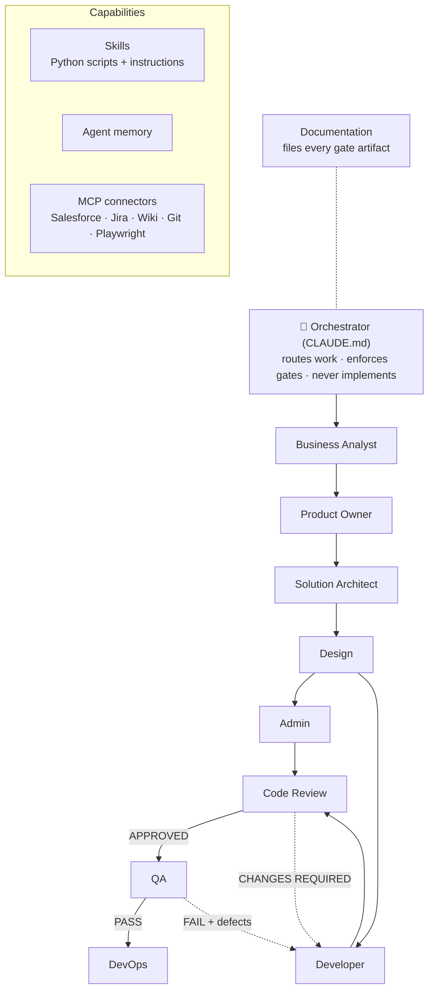

# Agentic AI Delivery Lifecycle (ADLC) for Salesforce

> A **multi-agent framework** that runs the Salesforce SDLC — from BRD to production — with
> **10 specialist AI agents**, an **orchestrator**, **human approval gates**, **structured verdicts with
> loop-back routing**, **persistent agent memory**, **Python-backed skills**, and **MCP connectors**.


A generic, clean-room version of a framework I helped build professionally. No employer rules,
standards or data are included.

---

## Why multi-agent instead of one big prompt?

A single assistant asked to be BA, architect, developer, reviewer and release engineer at once cuts
corners and forgets constraints. Splitting the work into **focused roles with their own instructions,
tools and memory** — and forcing a reviewed document between each role — produces consistent,
governed output while humans stay in control of every decision.

## Architecture



## Building blocks

| Layer | Company analogy | In this repo |
|---|---|---|
| **Orchestrator** | Delivery manager | `CLAUDE.md` — pipeline, gate rules, verdict routing, loop budget |
| **Agents** | One employee per role | `.claude/agents/*.md` (generated by `scripts/generate_agents.py`) |
| **Skills** | Expert playbooks | `.claude/skills/*` — instructions + deterministic Python scripts |
| **Memory** | Team knowledge | `.claude/agent-memory/<agent>/MEMORY.md` |
| **MCP** | Tools on the desk | `.mcp.json` — Salesforce DX, Atlassian, GitLab, Playwright |

## Gates, verdicts and loop-backs

Every gate agent ends with a machine-readable block:

```
VERDICT: CHANGES REQUIRED
REASON: SOQL inside loop in OrderService
FINDINGS: [ { id: CR-1, severity: Critical, summary: "SOQL in loop", suspected_cause: "OrderService.cls:42" } ]
RECOMMENDED_NEXT: developer
```

The orchestrator routes forward on approval and **backward** on failure (e.g. QA `FAIL` → developer →
code-review → QA again). Loop-backs pause for human confirmation and are capped at **2 per gate** to
prevent infinite ping-pong.

## Skills (why Python?)

LLMs are expensive and inconsistent at parsing PDFs, generating spreadsheets or running pattern checks.
Skills move that work into scripts so the agent only reasons over compact, reliable results.

| Skill | Script | What it does |
|---|---|---|
| `brd-to-stories` | `brd_to_stories.py` | BRD PDF/MD → requirements → component mapping, work type, points → Excel backlog |
| `apex-standards-review` | `scan_apex.py` | Static checks: SOQL/DML in loops, missing `with sharing` / `WITH USER_MODE`, injection, hard-coded IDs, empty catch, tests without asserts |

Try the scanner:

```bash
python .claude/skills/apex-standards-review/scripts/scan_apex.py examples/
```

## Get started

```bash
python scripts/generate_agents.py          # (re)generate the 10 agent definitions + memory files
claude                                     # open Claude Code in this folder
> We need a BRD for: auto-assign high-priority cases to the right queue
```

## Results in practice

- Discovery-to-design artifacts drafted in hours instead of days, with every step human-approved.
- Consistent standards: every build runs the same scanner + Code Analyzer before review.
- Full traceability: one project folder holds the BRD, impact analysis, design, review and QA report.

## License

MIT © Naman G Shetty
